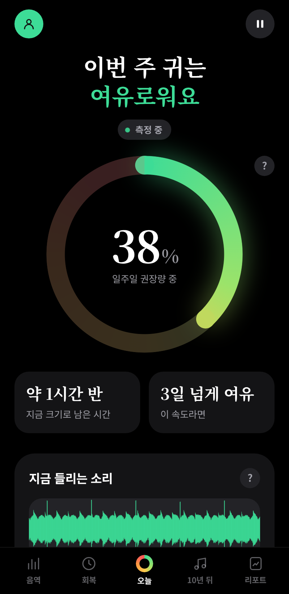
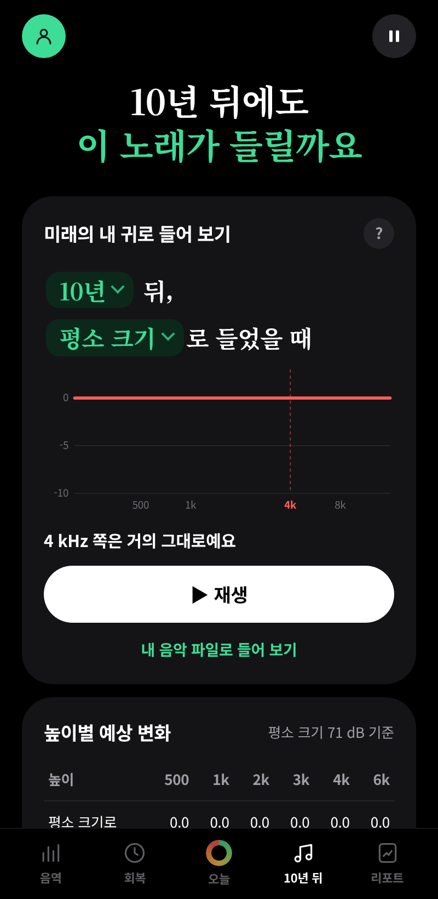
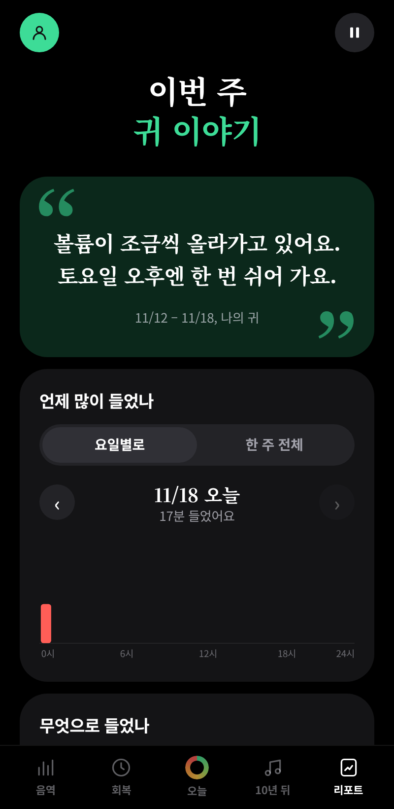
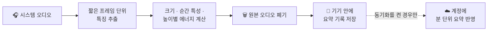

<div align="center">


<h1>SafeEar</h1>


<p>소리의 크기뿐 아니라 어떤 소리를 얼마나 오래 들었는지,<br/>쉬는 동안 부담이 어떻게 달라지는지까지 살펴보는 청취 모니터링 앱입니다.</p>

<p>
  
  
  
  
  
</p>

<p>
  <a href="#safeear-소개">소개</a> ·
  <a href="#주요-화면">화면</a> ·
  <a href="#측정은-어떻게-이루어지나요">측정 방식</a> ·
  <a href="#개인정보와-오디오-처리">개인정보</a> ·
  <a href="#설치-및-사용">설치</a> ·
  <a href="#과학적-근거">근거</a>
</p>

</div>

<br/>

> [!IMPORTANT]
> **SafeEar는 의료기기가 아닙니다.** 난청이나 다른 질환을 진단·치료하지 않으며, 청력검사나 이비인후과 전문의의 평가를 대신하지 않습니다.

## SafeEar 소개

SafeEar는 이어폰·헤드폰 청취로 쌓이는 소리 부담을 추정해 보여 주는 앱입니다. 볼륨과 시간만 기록하는 데서 그치지 않고, 소리의 시간적 특징과 높이별 분포, 청취 사이의 휴식까지 함께 살펴봅니다.

앱의 중심에는 한 가지 질문이 있습니다.

<div align="center">

### *이번 주에는 얼마나 들었고, 지금은 잠깐 쉬어 갈 때일까요?*

</div>

SafeEar는 PC와 Mac에서 재생되는 소리를 백그라운드에서 분석합니다. 창을 닫아도 Windows 알림 영역이나 macOS 메뉴 막대에 남아 측정을 이어갑니다. 모바일 기기까지 한 사람의 기록으로 연결하는 방향으로 확장하고 있습니다.

## 주요 화면

<table>
  <tr>
    <td align="center" width="20%"></td>
    <td align="center" width="20%"></td>
    <td align="center" width="20%"></td>
    <td align="center" width="20%"></td>
    <td align="center" width="20%"></td>
  </tr>
  <tr>
    <td align="center"><b>오늘</b></td>
    <td align="center"><b>음역</b></td>
    <td align="center"><b>회복</b></td>
    <td align="center"><b>10년 뒤</b></td>
    <td align="center"><b>리포트</b></td>
  </tr>
</table>

평소에는 핵심 상태만 간단히 보여 주고, 수치 옆의 `?`를 누르면 사용한 기준과 계산 근거를 확인할 수 있습니다.

| 화면 | 무엇을 볼 수 있나요? |
|---|---|
| **오늘** | 이번 주 권장 청취량 중 사용한 비율, 현재 상태, 남은 시간과 한도 도달 예상 시점 |
| **음역** | 낮은 소리부터 높은 소리까지 높이별 부담 분포. 귀가 민감한 것으로 알려진 높은 소리 구간을 따로 표시합니다 |
| **회복** | 쉬는 시간에 따라 추정 부담이 어떻게 달라지는지 확인하고 휴식 타이머를 사용합니다 |
| **10년 뒤** | 지금 청취 습관이 이어지는 상황을 소리로 비교합니다. 볼륨을 줄인 시나리오도 함께 들어 볼 수 있습니다 |
| **리포트** | 요일과 시간대별 청취 패턴, 콘텐츠별 기록, 볼륨 변화를 한 주 단위로 돌아봅니다 |

<sub>위 화면은 예시 데이터로 그린 미리보기입니다. 각 화면의 세부 구성은 버전에 따라 달라질 수 있습니다.</sub>

## SafeEar가 살펴보는 것

<table>
  <tr>
    <td width="50%" valign="top">
      <h4>🔊 소리의 크기와 청취 시간</h4>
      국제 청취 기준을 바탕으로 최근 7일 동안의 청취 부담을 누적해 보여 줍니다. 기본 기준은 청소년과 민감 사용자를 고려한 주간 기준이며, 성인 기준으로 바꿀 수 있는 선택지도 둡니다.
    </td>
    <td width="50%" valign="top">
      <h4>⚡ 소리의 순간적인 특성</h4>
      평균 크기가 비슷하더라도 순간적으로 튀는 소리가 많은 경우를 따로 살펴봅니다. 이런 차이를 계산에 반영하는 보정 방식을 연구·적용하고 있습니다.
    </td>
  </tr>
  <tr>
    <td valign="top">
      <h4>🎚️ 높이별 소리 분포</h4>
      소리를 여러 높이 구간으로 나누어 어느 구간이 많이 포함되었는지 보여 줍니다. 전체 부담 점수에 무조건 더하는 가중치가 아니라, 소리의 구성을 따로 살펴보는 지도로 제시합니다.
    </td>
    <td valign="top">
      <h4>⏸️ 휴식에 따른 변화</h4>
      청취가 멈춘 시간도 계산에 포함합니다. 회복 화면은 휴식 시간에 따른 모델상의 변화를 보여 주지만, 실제 귀 조직의 회복을 측정하는 기능은 아닙니다.
    </td>
  </tr>
  <tr>
    <td colspan="2" valign="top">
      <h4>⚖️ 기준값과 SafeEar 추정값 비교</h4>
      에너지와 시간만 반영한 기준값과, 소리의 순간적인 특성 및 휴식 모델을 반영한 SafeEar 값을 같은 축에서 비교합니다. 두 값의 차이로 계산 방식에 따라 결과가 어떻게 달라지는지 확인할 수 있습니다.
    </td>
  </tr>
</table>

## 측정은 어떻게 이루어지나요?

가능한 경우 기기에서 재생되는 오디오를 짧은 단위로 분석한 뒤, 계산에 필요한 특징값만 남깁니다.



> [!NOTE]
> **원본 오디오를 녹음 파일로 저장하거나 서버에 올리지 않는 것**이 설계 원칙입니다. 계정 동기화를 쓰더라도 서버로 보내는 데이터는 분 단위 요약 기록으로 제한합니다.

<details>
<summary><b>측정 등급 자세히 보기</b></summary>
<br/>

운영체제와 오디오 입력 경로에 따라 얻을 수 있는 정보가 다릅니다. SafeEar는 측정 경로의 차이를 숨기지 않고 구분하는 것을 목표로 합니다.

| 등급 | 입력 방식 | 확인할 수 있는 정보 |
|---|---|---|
| **A · 자체 재생** | SafeEar가 직접 재생하는 소리 | 소리의 크기와 세부 특징 |
| **B · 시스템 캡처** | 운영체제를 통해 받은 다른 앱의 소리 | 소리의 크기와 세부 특징. 캡처 지점에 따른 오차가 있을 수 있습니다 |
| **C · 레벨 전용** | 시스템이 제공하는 볼륨·청취 레벨 정보 | 소리의 크기 중심. 파형이 없어 세부 특징은 측정할 수 없습니다 |
| **D · 대리 추정** | 같은 곡 또는 콘텐츠 유형의 기준 자료를 이용한 추정 | 실제 파형 측정이 아닌 추정 정보이며, 실측값과 구별해 표시해야 합니다 |

측정 등급은 플랫폼과 세션에 따라 달라질 수 있습니다. 파형을 얻지 못한 경우 첨도나 높이별 분포를 실제 측정값인 것처럼 채우지 않습니다.

</details>

## 개인정보와 오디오 처리

SafeEar는 사용자가 무엇을 듣는지보다, 청취로 어느 정도의 부담이 쌓이는지에 초점을 둡니다.

| 원칙 | 내용 |
|---|---|
| **원본 오디오 저장 금지** | 특징값을 추출한 뒤 원본 오디오는 폐기합니다 |
| **로컬 우선** | 기록은 먼저 사용자의 기기에 저장합니다 |
| **선택적 동기화** | 로그인 없이 한 기기에서 쓸 수 있고, 동기화를 켠 경우에만 여러 기기의 요약 기록을 합산합니다 |
| **최소 수집** | 실명·학교·전화번호를 수집하지 않습니다 |
| **기기 간 비교 금지** | 서로 다른 기기의 볼륨 숫자는 같은 의미가 아니므로 단순 비교하지 않습니다 |

실제 배포 버전의 개인정보 처리 범위와 보관 기간은 해당 버전과 개인정보 처리방침을 기준으로 확인해야 합니다. 공개 배포 전에는 동기화·계정 삭제·데이터 내보내기 정책을 함께 안내합니다.

## AI는 어디에 사용하나요?

기본 계산 경로는 표준과 논문에 근거한 수식으로 구성합니다. 기본 선량 계산 자체를 학습 모델의 예측에 맡기지 않습니다. AI는 표준 계산만으로 답하기 어려운 해석 영역에 배치합니다.

- **청취 패턴 예측**: 최근 기록으로 앞으로의 청취 부담과 기준 도달 시점을 추정합니다.
- **볼륨 변화 탐지**: 콘텐츠나 출력 기기 차이를 고려하면서 평소보다 볼륨이 점차 높아지는 패턴을 살펴봅니다.
- **콘텐츠 분류**: 소리의 종류를 분류해 어떤 콘텐츠에서 기록이 많이 생겼는지 정리합니다.

이 항목들은 데이터 수집과 검증이 필요한 확장 기능이며, 모든 배포 버전에 포함되어 있다는 뜻은 아닙니다.

## 지원 플랫폼

| 플랫폼 | 상태 | 내용 |
|---|:---:|---|
| **macOS** | ✅ 지원 | macOS 13 이상, Apple 실리콘. 시스템 소리 캡처·볼륨·출력 장치 감지·메뉴 막대 실행 |
| **Windows** | 🧪 검증 중 | 시스템 오디오를 분석하고 알림 영역에서 실행되는 앱. 설치 파일 빌드를 지원합니다 |
| **Android** | 🗺️ 계획 | 시스템 오디오 캡처와 백그라운드 수집기로 실생활 기록 확장 |
| **iOS · iPadOS** | 🗺️ 계획 | 건강 앱의 헤드폰 청취 레벨 등 플랫폼 제공 정보와, OS 버전에 따라 허용되는 캡처 방법 조합 |
| **Web** | 🗺️ 검토 | 공통 계산 코어와 대시보드 활용 |

플랫폼마다 다른 앱의 소리에 접근할 수 있는 범위와 사용자 동의 절차가 다릅니다. 한 플랫폼에서 가능한 측정이 다른 플랫폼에서도 똑같이 제공된다고 가정하지 않습니다.

## 설치 및 사용

### 소스에서 빌드하기

Node.js와 npm이 필요합니다.

```bash
npm install
```

```bash
npm run desktop:mac    # macOS → collector-desktop/release/SafeEar-<버전>-arm64.dmg
```

```bash
npm run desktop:dist   # Windows → NSIS 설치 파일
```

로그인과 기기 간 동기화를 쓰려면 `collector-desktop/.env.example`을 `collector-desktop/.env`로 복사하고 Supabase 주소와 publishable 키를 넣습니다. 이 파일이 없으면 「로그인 없이 사용」만 할 수 있습니다.

<details>
<summary><b>macOS에서 앱이 열리지 않을 때</b></summary>
<br/>

개발자 서명이 없는 빌드라 다른 Mac에서 받은 앱은 macOS가 막을 수 있습니다. 터미널에서 다음을 실행한 뒤 다시 열어 보세요.

```bash
xattr -cr /Applications/SafeEar.app
```

처음 실행하면 **시스템 설정 → 개인정보 보호 및 보안 → 화면 및 시스템 오디오 녹음**에서 SafeEar를 허용해야 소리를 분석할 수 있습니다.

</details>

### 사용하기

1. SafeEar를 실행한 상태에서 이어폰 또는 헤드폰으로 소리를 듣습니다.
2. **오늘** 화면에서 이번 주 상태를 확인합니다.
3. 창을 닫아도 측정은 계속됩니다. 앱을 종료하지 말고 알림 영역(Windows)이나 메뉴 막대(macOS)에 실행 중인지 확인합니다.
4. 더 자세한 내용은 **음역**, **회복**, **10년 뒤**, **리포트**에서 살펴봅니다.

> [!TIP]
> 스피커 출력은 개인용 이어폰·헤드폰 청취량과 구분해야 합니다. 출력 장치나 보호된 콘텐츠에 따라 일부 소리가 분석되지 않을 수 있습니다.

## 수치와 예측을 읽을 때

SafeEar의 수치는 실제 고막에 도달한 음압이나 개인의 청력 역치를 직접 측정한 값이 아닙니다. 출력 기기, 이어폰 감도, 착용 상태, 시스템 음향 효과 등에 따라 추정 오차가 생길 수 있습니다.

> [!WARNING]
> - **주간 비율**: 국제 기준을 바탕으로 계산한 청취 부담 추정치입니다. '안전' 또는 '위험 없음'을 보증하는 판정이 아닙니다.
> - **회복**: 모델에 따른 부담 변화입니다. 쉬는 동안 실제 청각 기관이 회복되었다는 뜻은 아닙니다.
> - **10년 뒤**: 통계 모델에 기반한 가상 시나리오를 소리로 표현한 것입니다. 개인의 미래 청력을 예언하거나 청력검사를 대신하지 않습니다.
> - **개인차**: 일부 보정식과 회복 모델은 성인 또는 산업 소음 연구에서 가져온 것으로, 청소년의 음악·게임 청취 환경에서 충분히 검증되었다고 볼 수 없습니다.

청력에 불편함이 있다면 의료 전문가에게 확인해 주세요.

## 과학적 근거

<details>
<summary><b>참고 자료 목록 펼치기</b></summary>
<br/>

| 자료 | 설계에서 참고하는 내용 |
|---|---|
| **ITU-T H.870** | 개인 오디오 시스템의 청취 시간과 주간 기준 선량 |
| **ISO 1999:2013** | 소음 노출과 연령 관련 청력 역치 변화의 통계적 추정 |
| **ISO 226:2023** | 소리의 높이별 청감 특성을 고려하는 A-가중의 배경 |
| **Goley, Song & Kim (2011); Zhao et al. (2010); Xie et al. (2016)** | 복합 소음의 시간적 특성을 고려하는 첨도 관련 연구 |
| **Patuzzi (1998)** | 청각 역치 변화의 시간 경과와 회복 동역학에 관한 연구 |
| **YAMNet / AudioSet** | 콘텐츠 유형 분류를 위한 사전학습 오디오 모델 검토 |

참고 문헌의 결과를 모든 이어폰·음악 환경에 그대로 적용할 수는 없습니다. 각 모델이 사용된 연구 모집단과 적용 한계도 함께 고려합니다.

</details>

## 개발 원칙

- **측정과 해석의 분리**: 측정·계산은 검증 가능한 수식으로 처리하고, AI는 예측과 해석에 사용합니다.
- **관찰은 기록하고 원인은 단정하지 않기**: 청취 패턴을 보여 주되, 그 원인을 질환이나 청력 손상으로 단정하지 않습니다.
- **절대 판정보다 같은 조건에서의 변화**: 기기별 교정 오차를 고려해 같은 사용자·같은 기기 조합 안의 상대적인 변화에 무게를 둡니다.
- **측정 한계를 숨기지 않기**: 실측·레벨 전용·추정 데이터를 구분합니다.
- **비교와 낙인 대신 자기 기록**: 친구나 학급과 순위를 매기는 기능은 두지 않고, 자신의 기록을 돌아보는 데 집중합니다.

<details>
<summary><b>저장소 구조</b></summary>
<br/>

```text
core/               계산 코어 (A-가중 · FFT · 1/3 옥타브 · 첨도 · H.870 선량 · 회복 모델)
collector-desktop/  Electron 앱 (macOS · Windows)
  src/main/         백그라운드 측정 · 트레이/메뉴 막대 · 로그인 · 동기화
  src/engine/       시스템 소리 캡처와 1초 단위 특징 추출
  src/ui/           화면
server/supabase/    데이터베이스 스키마와 접근 정책
```

</details>

<br/>

<div align="center">
  
  <sub>SafeEar · 청취 습관을 돌아보기 위한 추정 도구</sub>
</div>
