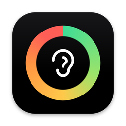
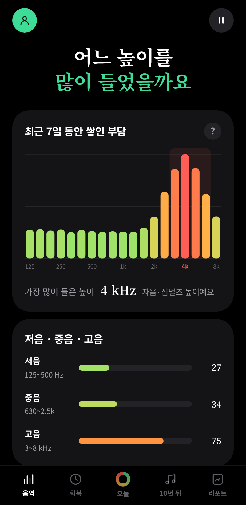
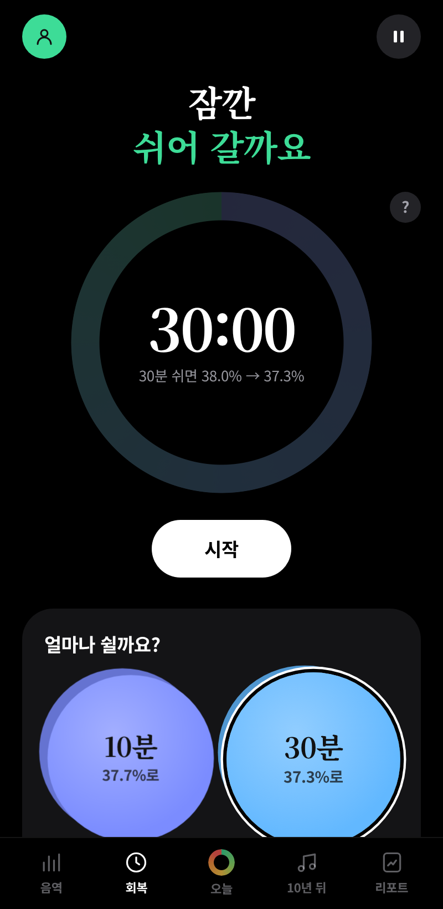
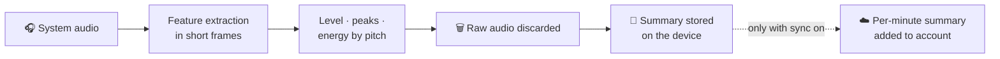

<div align="center">



<h1>SafeEar</h1>


<p>A listening monitor that looks past loudness: what you heard, for how long,<br/>and how the load changes while you rest.</p>

<p>
  
  
  
  
  
</p>

<p><b>English</b> | <a href="README.ko.md">한국어</a></p>

<p>
  <a href="#about">About</a> ·
  <a href="#screens">Screens</a> ·
  <a href="#how-measurement-works">Measurement</a> ·
  <a href="#privacy-and-audio">Privacy</a> ·
  <a href="#install-and-use">Install</a> ·
  <a href="#references">References</a>
</p>

</div>

<br/>

> [!IMPORTANT]
> **SafeEar is not a medical device.** It does not diagnose or treat hearing loss or any other condition, and it does not replace a hearing test or an assessment by an ENT specialist.

## About

SafeEar estimates the load that builds up from listening through earphones and headphones. It goes beyond volume and time: it also looks at how sound changes from moment to moment, how it spreads across pitch, and the breaks between listening sessions.

The app is built around one question.

<div align="center">

### *How much have I listened this week, and is it time for a short break?*

</div>

SafeEar analyzes the sound your PC or Mac plays, in the background. Close the window and it keeps measuring from the Windows notification area or the macOS menu bar. We are working toward joining records from mobile devices into one person's history.

## Screens

<table>
  <tr>
    <td align="center" width="20%"></td>
    <td align="center" width="20%"></td>
    <td align="center" width="20%"></td>
    <td align="center" width="20%"></td>
    <td align="center" width="20%"></td>
  </tr>
  <tr>
    <td align="center"><b>Today</b></td>
    <td align="center"><b>Frequency</b></td>
    <td align="center"><b>Recovery</b></td>
    <td align="center"><b>In 10 years</b></td>
    <td align="center"><b>Report</b></td>
  </tr>
</table>

Day to day, the app shows only the key status. Tap `?` next to a number to see the standard and the calculation behind it. The app itself is in Korean.

| Screen | What you see |
|---|---|
| **Today** | Share of this week's recommended listening used, current status, time left, and when you are likely to reach the limit |
| **Frequency** | Load by pitch, from low to high. The high range, where ears are known to be more sensitive, is marked separately |
| **Recovery** | How the estimated load changes with rest, plus a break timer |
| **In 10 years** | Hear what your current habits could sound like later, next to a lower-volume scenario |
| **Report** | Listening by weekday and hour, by content, and volume changes over the week |

<sub>Screens are a preview rendered with sample data. Details may vary between versions.</sub>

## What SafeEar looks at

<table>
  <tr>
    <td width="50%" valign="top">
      <h4>🔊 Loudness and listening time</h4>
      Listening load over the last 7 days, based on an international listening standard. The default weekly limit is set for teenagers and sensitive listeners; an adult limit is available as an option.
    </td>
    <td width="50%" valign="top">
      <h4>⚡ Sudden peaks</h4>
      Two sounds can have the same average level while one has many sharp peaks. SafeEar treats them separately and applies a correction for that difference, which we are still studying.
    </td>
  </tr>
  <tr>
    <td valign="top">
      <h4>🎚️ Distribution by pitch</h4>
      Sound is split into pitch bands to show which ones dominate. This is a map for looking at the makeup of what you heard, not a weight added to the overall score.
    </td>
    <td valign="top">
      <h4>⏸️ Change during rest</h4>
      Time without listening counts too. The Recovery screen shows how the model changes with rest; it does not measure whether your ears have actually recovered.
    </td>
  </tr>
  <tr>
    <td colspan="2" valign="top">
      <h4>⚖️ Standard value vs. SafeEar estimate</h4>
      A value based on energy and time alone sits on the same axis as the SafeEar value, which adds peaks and the rest model. The gap shows how much the result depends on the method.
    </td>
  </tr>
</table>

## How measurement works

Where possible, the audio your device plays is analyzed in short frames, and only the features needed for the calculation are kept.



> [!NOTE]
> **Raw audio is never saved as a recording or uploaded.** With account sync on, only per-minute summaries leave the device.

<details>
<summary><b>Measurement grades</b></summary>
<br/>

What can be measured depends on the operating system and the audio path. SafeEar labels the path instead of hiding it.

| Grade | Input | What it gives |
|---|---|---|
| **A · Own playback** | Sound played by SafeEar itself | Level and detailed features |
| **B · System capture** | Other apps' sound received through the OS | Level and detailed features; some error depending on the capture point |
| **C · Level only** | Volume or listening level reported by the system | Mostly level; no waveform, so no detailed features |
| **D · Proxy estimate** | Reference data for the same track or content type | An estimate, not a waveform measurement; must be shown apart from measured values |

Grades can differ by platform and session. Without a waveform, kurtosis and the pitch distribution are never filled in as if they were measured.

</details>

## Privacy and audio

SafeEar cares about how much load builds up, not what you listen to.

| Principle | What it means |
|---|---|
| **No raw audio** | Audio is discarded once the features are extracted |
| **Local first** | Records are stored on your device first |
| **Optional sync** | Works on one device without an account; summaries from several devices are combined only with sync on |
| **Minimal collection** | No real name, school, or phone number |
| **No cross-device comparison** | Volume numbers on different devices mean different things, so they are not compared directly |

For a released version, check that version and its privacy policy for what is processed and how long it is kept. Sync, account deletion, and data export policies will be published before public release.

## Where AI fits

The core calculation is built from standards and published formulas. The dose itself is never left to a trained model's prediction. AI is reserved for interpretation that the standard math cannot answer.

- **Listening forecast**: estimates future load and when you will reach the limit, from recent records.
- **Volume creep detection**: spots volume drifting up over time while accounting for differences in content and output device.
- **Content classification**: sorts sound by type to show which kinds of content produced the most load.

These are extensions that need data collection and validation. Not every release includes all of them.

## Platforms

| Platform | Status | Notes |
|---|:---:|---|
| **macOS** | ✅ Supported | macOS 13+, Apple silicon. System audio capture, volume, output device detection, menu bar |
| **Windows** | 🧪 Testing | Background analysis from the notification area. Installer builds are supported |
| **Android** | 🗺️ Planned | System audio capture and a background collector |
| **iOS · iPadOS** | 🗺️ Planned | Headphone audio levels from Health, combined with whatever capture the OS version allows |
| **Web** | 🗺️ Exploring | Shared calculation core and a dashboard |

Each platform limits access to other apps' audio differently and asks for consent differently. What works on one platform is not assumed to work on another.

## Install and use

### Build from source

Requires Node.js and npm.

```bash
npm install
```

```bash
npm run desktop:mac    # macOS → collector-desktop/release/SafeEar-<version>-arm64.dmg
```

```bash
npm run desktop:dist   # Windows → NSIS installer
```

For sign-in and sync, copy `collector-desktop/.env.example` to `collector-desktop/.env` and fill in the Supabase URL and publishable key. Without it, only offline use is available.

<details>
<summary><b>If the app won't open on macOS</b></summary>
<br/>

The build is not signed with a developer certificate, so macOS may block a copy downloaded on another Mac. Run this in Terminal and open it again.

```bash
xattr -cr /Applications/SafeEar.app
```

On first launch, allow SafeEar under **System Settings → Privacy & Security → Screen & System Audio Recording** so it can analyze sound.

</details>

### Using it

1. Keep SafeEar running while you listen through earphones or headphones.
2. Check this week's status on **Today**.
3. Closing the window does not stop measuring. Don't quit the app; make sure it is in the notification area (Windows) or menu bar (macOS).
4. Dig deeper in **Frequency**, **Recovery**, **In 10 years**, and **Report**.

> [!TIP]
> Speaker output should be kept apart from personal earphone and headphone listening. Some sound may not be analyzed depending on the output device or protected content.

## Reading the numbers

SafeEar's numbers are not measurements of the sound pressure reaching your eardrum or of your hearing threshold. Output device, earphone sensitivity, fit, and system sound effects all add estimation error.

> [!WARNING]
> - **Weekly percentage**: an estimate of listening load based on an international standard. It does not certify that listening is "safe" or "risk-free".
> - **Recovery**: a change in the model. It does not mean your hearing has actually recovered during rest.
> - **In 10 years**: a hypothetical scenario from a statistical model, rendered as sound. It does not predict your hearing or replace a hearing test.
> - **Individual differences**: some corrections and the recovery model come from studies of adults or industrial noise and are not well validated for teenagers listening to music or games.

If you notice any discomfort in your hearing, see a medical professional.

## References

<details>
<summary><b>Show sources</b></summary>
<br/>

| Source | Used for |
|---|---|
| **ITU-T H.870** | Listening time and weekly reference dose for personal audio systems |
| **ISO 1999:2013** | Statistical estimation of noise- and age-related hearing threshold shift |
| **ISO 226:2023** | Background for A-weighting by pitch |
| **Goley, Song & Kim (2011); Zhao et al. (2010); Xie et al. (2016)** | Kurtosis and the temporal structure of complex noise |
| **Patuzzi (1998)** | Time course and recovery dynamics of threshold shift |
| **YAMNet / AudioSet** | Pretrained audio models considered for content classification |

These findings do not transfer directly to every earphone or music setting. The populations behind each model and their limits are taken into account.

</details>

## Design principles

- **Measurement apart from interpretation**: calculations use verifiable formulas; AI is for forecasting and interpretation.
- **Record what is observed, don't name a cause**: listening patterns are shown without attributing them to disease or hearing damage.
- **Change under the same conditions over absolute verdicts**: given calibration error between devices, the focus is on relative change for the same user and device.
- **Show the limits of measurement**: measured, level-only, and estimated data are kept apart.
- **Your own record, not rankings**: no comparisons or leaderboards with friends or classmates.

<details>
<summary><b>Repository layout</b></summary>
<br/>

```text
core/               Calculation core (A-weighting · FFT · 1/3-octave · kurtosis · H.870 dose · recovery model)
collector-desktop/  Electron app (macOS · Windows)
  src/main/         Background measurement · tray/menu bar · sign-in · sync
  src/engine/       System audio capture and per-second feature extraction
  src/ui/           Screens
server/supabase/    Database schema and access policies
```

</details>

<br/>

<div align="center">
  
  <sub>SafeEar · an estimation tool for looking back on listening habits</sub>
</div>
